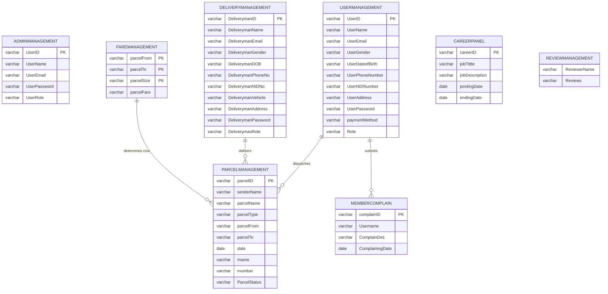

# Quick Eagle Courier Service — Nationwide Express Logistics Platform

[](https://www.php.net/)
[](https://www.mysql.com/)
[](#system-architecture)
[](https://developer.mozilla.org/)
[](https://shakiljamil.github.io/courier/)

> **Quick Eagle Courier Service** is an enterprise-grade digital logistics and parcel management platform engineered to streamline end-to-end parcel dispatches across all 8 administrative divisions of Bangladesh. Built using an **MVC (Model-View-Controller)** pattern with **PHP, MySQL, and JavaScript**, the system provides automated distance-and-weight delivery charge estimation, live consignment status tracking, role-based workflows for Admins, Customers (Members), and Delivery Agents, and payment reconciliation.

---

## 🌐 Live Interactive Deployment

Experience the interactive web simulation deployed on GitHub Pages:
🔗 **[https://shakiljamil.github.io/courier/](https://shakiljamil.github.io/courier/)**

Features live in the web demo:
- **Consignment Tracking Engine:** Try sample tracking codes (`QE-84920`, `QE-99124`, `QE-77215`) to observe status timelines and routing logs.
- **Automated Delivery Fare Estimator:** Real-time rate computation across divisions with category multipliers and express speed tiers.
- **Dispatch Booking Simulation:** Form generation producing unique tracking IDs stored in session memory.
- **Division Hub Mesh:** Operational directory for Dhaka, Chittagong, Sylhet, Rajshahi, Khulna, Barishal, Rangpur, and Mymensingh.

---

## 🏛️ System Architecture

The platform strictly separates presentation, business logic, and database persistence through a clean **Model-View-Controller (MVC)** architectural pattern:

```mermaid
flowchart TD
    subgraph Client ["Client Layer (Browser)"]
        UI_Home["Public Portal (Landing, About, Services)"]
        UI_Member["Customer Portal (Booking, Tracking, History)"]
        UI_Deli["Delivery Agent Hub (Assignments, Reviews)"]
        UI_Admin["Admin Operations Panel (Monitoring, Overrides)"]
    end

    subgraph Controllers ["Controller Layer (Business Logic & Validation)"]
        C_Auth["LoginChecker.php / userRegistrationChecker.php"]
        C_Fare["CostEstimationCheck.php / area-based-pay_check.php"]
        C_Track["ParcelTrackController.php / ParcelSearchController.php"]
        C_Parcel["parcelmanagementcheck.php / EditParcelCheckAdmin.php"]
        C_Comp["ComplainCheckMamber.php / ban-controller.php"]
    end

    subgraph Models ["Model Layer (Data Abstraction & DAO)"]
        M_DB["dbModel.php (Database Connection Pool)"]
        M_User["UserModel.php / DeliverymanModel.php"]
        M_Parcel["parcelmgtModel.php / inventoryModel.php"]
        M_Career["CareerPanelModel.php / notificationModel.php"]
    end

    subgraph Database ["Persistence Layer (MySQL / MariaDB)"]
        DB_User[("usermanagement / adminmanagement")]
        DB_Parcel[("parcelmanagement / faremanagement")]
        DB_Deli[("deliverymanagement / reviewmanagement")]
        DB_Ops[("membercomplain / careerpanel")]
    end

    Client -->|HTTP POST / AJAX| Controllers
    Controllers -->|Invoke CRUD| Models
    Models -->|SQL Queries via mysqli| Database
    Database -->|Result Sets / Row Arrays| Models
    Models -->|Data Transfer Objects| Controllers
    Controllers -->|Render View / JSON| Client
```



---

## 🗄️ Relational Database Schema & Entity-Relationship Diagram

The underlying MariaDB/MySQL database (`project_SQL/SQL.txt`) manages relational integrity across users, roles, parcels, and multi-tier pricing structures:



---

## ⚡ Core Functional Modules

### 1. Automated Delivery Fare Estimation Engine
- Implements an exact inter-city distance and package classification algorithm based on the `faremanagement` matrix.
- Calculates dynamic fares between any pair of the 8 administrative divisions of Bangladesh:
  - **Intra-city (Local Delivery):** Baseline rate (৳25 – ৳50).
  - **Inter-city (Regional Transit):** Distance multiplier + handling surcharge (৳55 – ৳105).
  - **Size / Weight Categories:** Discretized into `small`, `medium`, and `big` volume bands.

### 2. Real-Time Consignment Tracking Lifecycle
Each parcel passes through an explicit state machine:
```
[BOOKED] ➔ [PENDING PICKUP] ➔ [IN TRANSIT] ➔ [OUT FOR DELIVERY] ➔ [DELIVERED]
```
- Customers query their consignment status instantly using their unique 8-character `parcelID`.
- Admins and delivery personnel update tracking milestones with timestamped logs.

### 3. Role-Based Access Control (RBAC)
- **Admin (`ADM1`):** System telemetry, user/deliveryman account moderation, parcel status overrides, career posting management, complaint arbitration.
- **Member / Customer (`MEM1`):** Booking parcels, calculating freight charges, monitoring shipment timelines, profile updating, filing complaints.
- **Delivery Agent (`DEL1`):** Viewing assigned delivery routes, updating handover statuses, tracking customer reviews and earnings.

### 4. Financial & Payment Reconciliation
- Supports **Cash on Delivery (COD)**, **bKash Mobile Financial Services (MFS)**, and prepaid counter receipts.
- Includes invoice generation controllers (`invoiceController.php`) and payment status checks (`updatepayCheck.php`).

---

## 📂 Codebase Directory Organization

```
web-tec-spring-23-24-sec-f-Finalproject-group-6/
├── asset/                        # Static client assets
│   ├── css/                      # Modular stylesheets (Admin, Delivery, Member, Layouts)
│   ├── js/                       # Client-side validation & AJAX scripts
│   └── img/                      # Brand assets, division maps, UI graphics
├── controller/                   # Business logic and request validators
│   ├── area-based-pay_check.php  # Distance & division fare calculation engine
│   ├── CostEstimationCheck.php   # Pricing algorithm verification
│   ├── LoginChecker.php          # Session & cookie-based authentication
│   ├── ParcelTrackController.php # Consignment telemetry lookup
│   ├── parcelmanagementcheck.php # Parcel state transition controller
│   └── userRegistrationChecker.php
├── model/                        # Data access layer (DAO)
│   ├── dbModel.php               # MySQLi database connection provider
│   ├── parcelmgtModel.php        # Parcel CRUD & tracking data persistence
│   ├── UserModel.php             # User profile and credential management
│   ├── DeliverymanModel.php      # Driver fleet management
│   └── notificationModel.php     # System broadcast alerts
├── project_SQL/                  # Database migration scripts
│   └── SQL.txt                   # Complete DDL & sample DML dataset
├── view/                         # User interface templates
│   ├── AdminPanel/               # Administrative monitoring & CRUD interfaces
│   ├── homepage/                 # Public landing pages (services, about, coverage)
│   ├── admindashboard.php        # Central executive dashboard
│   ├── deliverymandashboard.php  # Courier driver task interface
│   ├── MemberIndex.php           # Customer self-service portal
│   └── userLogin.php             # Secure authentication gateway
├── upfiles/                      # Stored delivery verification attachments
└── FunctionalitesModel.txt       # Core helper library & transaction routines
```

---

## 🛠️ Local Installation & Setup Guide

### Prerequisites
- **Web Server:** [XAMPP](https://www.apachefriends.org/), WampServer, or native Apache with PHP 7.4 – 8.2.
- **Database:** MySQL or MariaDB 10.4+.
- **Browser:** Any modern Chromium, Gecko, or WebKit browser.

### Step 1: Clone the Repository
Clone the repository into your local server root (e.g. `htdocs` for XAMPP):
```bash
cd C:/xampp/htdocs
git clone https://github.com/ShakilJamil/web-tec-spring-23-24-sec-f-Finalproject-group-6.git quickeagle
```

### Step 2: Database Migration
1. Start **Apache** and **MySQL** via the XAMPP Control Panel.
2. Navigate to [http://localhost/phpmyadmin/](http://localhost/phpmyadmin/) in your browser.
3. Create a new database named:
   ```sql
   CREATE DATABASE webtech;
   ```
4. Select `webtech`, click the **Import** tab, and choose:
   ```
   quickeagle/project_SQL/SQL.txt
   ```
5. Click **Go** to generate all tables and seed initial records.

### Step 3: Database Connection Configuration
Verify the credentials in `model/dbModel.php`:
```php
function getConnection() {
    $host = '127.0.0.1';
    $dbuser = 'root';
    $dbpass = '';
    $dbname = 'webtech';
    $con = mysqli_connect($host, $dbuser, $dbpass, $dbname);
    return $con;
}
```

### Step 4: Launch Application
Open your browser and navigate to:
```
http://localhost/quickeagle/view/homepage/aboutus.php
```

### Default Credentials:
| Role | Email | Password |
|------|-------|----------|
| **Admin** | `admin@gmail.com` | `admin404` |
| **Member (Customer)** | `mafialhasan@gmail.com` | `00000000` |
| **Delivery Agent** | `kamal@gmail.com` | `11111111` |

---

## 👨‍💻 Author & Academic Affiliation
- **Author:** Shakil Jamil Mrida
- **Degree:** B.Sc in Computer Science & Engineering
- **Institution:** American International University-Bangladesh (AIUB)
- **Course:** Web Technologies (Spring 2023–2024)
- **GitHub:** [@ShakilJamil](https://github.com/ShakilJamil)
- **Portfolio:** [shakiljamil.github.io](https://shakiljamil.github.io/)
